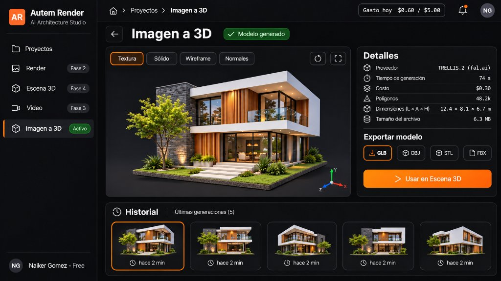

# AUTEM RENDER

Plataforma de estudio arquitectonico con inteligencia artificial para reconstruccion de Imagen a 3D, Render fotorrealista, Escena 3D orbital y generacion de Video. Disenada con arquitectura multi-proveedor que permite ejecutar modelos de forma 100 % local en tu propia GPU (via ComfyUI y servidores dedicados) o conectarse a motores en la nube con fallback automatico.



---

## Capacidades principales

- **Imagen a 3D**: Reconstruccion de mallas tridimensionales a partir de 1 a 4 fotografias o renders arquitectonicos. Incluye eliminacion automatica de fondo, generacion de texturas PBR, control de limite de poligonos, normalizacion de escala en metros reales, visor interactivo (Textura, Solido, Wireframe, Normales), comparador de modelos lado a lado y exportacion directa a GLB, OBJ y STL.
- **Render Arquitectonico**: Sintesis de imagen condicionada por bocetos, planos o capturas previas respetando la geometria original. Soporta estilos Photoreal, Clay y Linework, cambio de materiales predominantes (hormigon, madera, ladrillo, piedra, vidrio y acero), re-iluminacion (mediodia, atardecer, noche, nublado), exploracion de variaciones y mejora de resolucion (Upscale 2x / 4x).
- **Escena 3D (Orbit) y Revision de Clientes**: Importacion de modelos GLB, GLTF, OBJ y STL, captura de vistas exactas de camara con renderizado directo por vista y enlaces publicos compartidos para que el cliente orbite la maqueta y deje comentarios anclados sobre coordenadas 3D especificas.
- **Video Arquitectonico**: Animacion de recorridos de camara a partir de una imagen estatica (Push-in, Paneo lateral, Orbita) y transiciones fluidas entre dos renders distintos mediante modelos First-Last-Frame (FLF2V).

---

## Compatibilidad de modelos segun tu PC (Ejecucion Local vs API)

Autem Render se adapta al hardware disponible en tu equipo. Puedes trabajar sin tarjeta grafica dedicada usando proveedores remotos, o ejecutar los modelos de pesos abiertos directamente en tu tarjeta NVIDIA local a costo cero por generacion.

### 1. Resumen por perfil de hardware

| Perfil de PC | VRAM / Memoria | Que puedes ejecutar en Local | Recomendacion de configuracion |
|---|---|---|---|
| **Sin GPU dedicada** (Laptop integrada, CPU o Mac basica) | 0 GB VRAM (8-16 GB RAM) | Preprocesado de imagen, recorte de fondo y postprocesado de mallas (GLB/OBJ/STL) + Visor 3D WebGL | Usar proveedores remotos (Hugging Face Spaces, Stability SF3D, Tripo3D, Meshy o fal.ai) |
| **PC Gama Entrada** (RTX 3060 / RTX 4060) | 6 GB - 8 GB VRAM | TripoSR, Stable Fast 3D, renders SDXL / ControlNet en 1K y clips cortos con LTX-Video 2B | Modo mixto: previsualizacion y mallas rapidas en local; TRELLIS.2 o video largo por API |
| **PC Gama Media-Alta** (RTX 3080 / 4070 Ti / 4080) | 12 GB - 16 GB VRAM | TRELLIS v1, TRELLIS.2 (FP8 cuantizado), Flux.1 Dev (FP8) + ControlNet, Wan 2.2 TI2V 5B y LTX-2.5 Distilled | Ejecucion local completa en ComfyUI (:8188) para 3D, render 2K y video de 5 segundos |
| **Workstation / Gama Alta** (RTX 3090 / 4090 / 5090 / A5000) | 24 GB o mas VRAM | TRELLIS.2 4B PBR completo, Pixal3D, Hunyuan3D-2.x, Flux.1 Dev completo + Upscale 4K, Wan 2.2 14B y LTX-2.5 4K | Ejecucion 100 % local en maxima calidad sin depender de servicios externos |

---

### 2. Detalle de modelos locales por modulo y requisitos

#### Modulo: Imagen a 3D (Local)

| Modelo Local | VRAM Minima | VRAM Recomendada | Tiempo aprox. | Caracteristicas en arquitectura |
|---|---|---|---|---|
| **TripoSR** | 6 GB | 8 GB | 5 - 12 s | Ligero y muy rapido para volumetrias conceptuales basicas |
| **Stable Fast 3D (SF3D)** | 8 GB | 12 GB | 5 - 10 s | Genera malla con mapas UV y materiales rapidos |
| **TRELLIS (v1)** | 12 GB | 16 GB | 35 - 60 s | Soporta entrada multi-vista (2 a 4 angulos de la misma vivienda) |
| **TRELLIS.2 (4B PBR)** | 16 GB (FP8) | 24 GB (FP16) | 45 - 80 s | Materiales PBR completos y alta fidelidad geometrica en voladizos y fachadas |
| **Pixal3D** | 16 GB (FP8) | 24 GB (FP16) | 50 - 85 s | Alineacion estricta a la silueta y proporciones de la fotografia de entrada |
| **Hunyuan3D-2.x** | 16 GB | 24 GB | 60 - 110 s | Geometria densa y texturas detalladas (requiere GPU NVIDIA con soporte CUDA) |

#### Modulo: Render Arquitectonico y Upscale (Local en ComfyUI)

| Modelo Local | VRAM Minima | VRAM Recomendada | Uso dentro de Autem Render |
|---|---|---|---|
| **SDXL + ControlNet (Canny / Depth)** | 8 GB | 12 GB | Render rapido conservando lineas de bocetos o capturas de SketchUp |
| **Flux.1 Dev (FP8) + ControlNet** | 12 GB | 16 GB | Render fotorrealista editorial con materiales arquitectonicos precisos |
| **Flux.1 Dev (FP16 completo)** | 20 GB | 24 GB | Maxima nitidez en reflejos, carpinterias, vegetacion e iluminacion |
| **Real-ESRGAN / Clarity Local** | 6 GB | 12 GB | Escalado 2x y 4x de renders antes de exportacion final o paso a video |

#### Modulo: Video y Transiciones (Local en ComfyUI)

| Modelo Local | VRAM Minima | VRAM Recomendada | Modo soportado |
|---|---|---|---|
| **LTX-Video 2B** | 8 GB | 12 GB | Animar (1 imagen a video) en resolucion estandar con bajo consumo |
| **Wan 2.2 (TI2V 5B)** | 12 GB | 16 GB | Animar recorridos arquitectonicos (Push-in, Paneo, Orbita) con luz natural fluida |
| **LTX-2.5 Distilled (FLF2V)** | 12 GB | 16 GB | Transicion cinematografica entre primer y ultimo cuadro (2 renders) |
| **LTX-2.5 Completo / Wan 2.2 14B** | 24 GB | 24 GB+ | Recorridos y transiciones de alta definicion |

> Nota sobre compatibilidad de GPU: Los motores locales 3D como TRELLIS.2, Pixal3D y Hunyuan3D utilizan extensiones compiladas para **NVIDIA CUDA**. Si tu equipo tiene grafica AMD o integrada, puedes apuntar la URL de ComfyUI en la pestana de Configuracion hacia una instancia remota con GPU o utilizar cualquiera de los proveedores API integrados.

---

## Requisitos del sistema

- **Python**: 3.12 o superior (gestionado con `uv`).
- **Node.js**: 20 o superior (gestionado con `pnpm`).
- **Opcional para ejecucion local con GPU**: ComfyUI corriendo en `http://localhost:8188` con los nodos de TRELLIS.2, Flux, Wan 2.2 o LTX-2.5.

---

## Instalacion y puesta en marcha

1. Clonar el repositorio y preparar las variables de entorno:

```bash
git clone https://github.com/Naiker12/AUTEM-RENDER.git
cd AUTEM-RENDER
cp .env.example .env
```

2. Instalar dependencias del backend en Python e iniciar el servidor FastAPI (puerto `8000`):

```bash
uv sync
uv run uvicorn autem_api.main:app --reload --port 8000
```

3. En una segunda terminal, instalar dependencias del frontend e iniciar la aplicacion web Next.js (puerto `3000`):

```bash
pnpm --dir apps/web install
pnpm --dir apps/web dev
```

4. Abrir `http://localhost:3000` en el navegador y acceder a la seccion **Configuracion** para verificar los motores locales (`ComfyUI`, `Ollama`, `Servidor 3D`) o registrar claves de proveedores externos.

---

## Verificacion y pruebas

Para ejecutar las validaciones de tipos, linter y pruebas automatizadas del backend y workers:

```bash
pnpm --dir apps/web typecheck
uv run ruff check packages apps
uv run pytest
```
